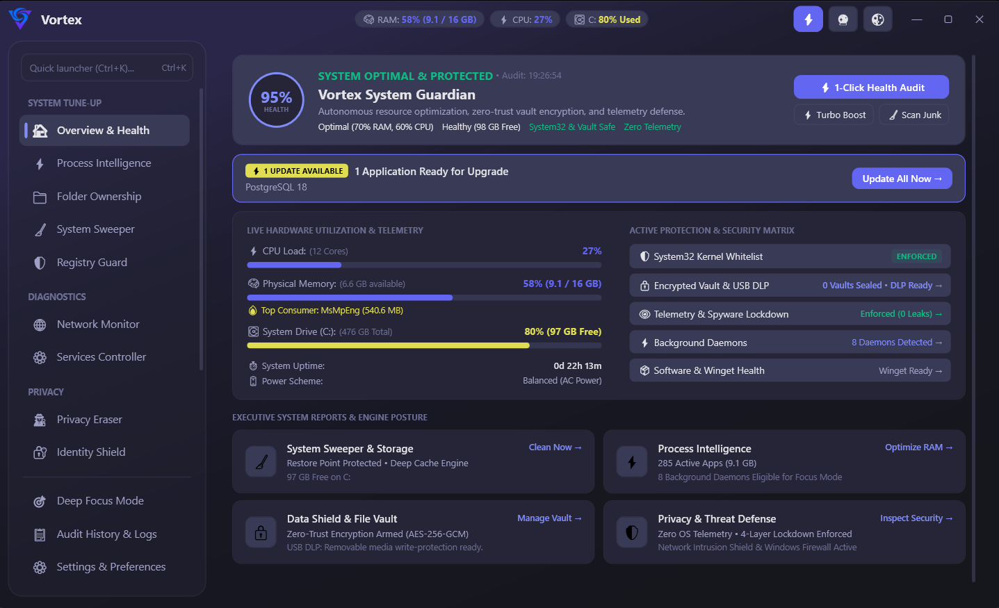

<div align="center">


# ⚡ Vortex System Guardian

**Next-Generation Windows Optimization, Zero-Trust Encryption Vault, Privacy Hardening & System Station**

[](https://microsoft.com/windows)
[](https://github.com/DaveHR1998/vortex/releases/tag/v2.0.0)
[-8A2BE2?style=flat-square)](https://dotnet.microsoft.com)
[](https://dotnet.microsoft.com)
[](https://docs.microsoft.com/dotnet/csharp/)
[](https://csrc.nist.gov)
[](https://sqlite.org)
[](LICENSE)

[**Technical Documentation**](TECHNICAL_DOCUMENTATION.md) • [**Download Setup (v2.0.0)**](Release_Installer/VortexSetup.exe) • [**Release Notes**](https://github.com/DaveHR1998/vortex/releases/tag/v2.0.0)

<br/><br/>

<!-- Primary Hero Dashboard Preview -->


</div>

---

## 📸 Interactive Module Showcase

<details open>
  <summary><b>🔒 Zero-Trust AES-256 Vault & Folder Camouflage</b> <i>(Click to toggle)</i></summary>
  <br/>
  <p align="center">
    
  </p>
</details>

<details>
  <summary><b>🌐 Live Rogue Socket & Network Threat Shield</b> <i>(Click to toggle)</i></summary>
  <br/>
  <p align="center">
    
  </p>
</details>

<details>
  <summary><b>🚀 Software Updater & Uninstaller Engine</b> <i>(Click to toggle)</i></summary>
  <br/>
  <p align="center">
    
  </p>
</details>

<details>
  <summary><b>🧹 System Sweeper & Residual Junk Cleaner</b> <i>(Click to toggle)</i></summary>
  <br/>
  <p align="center">
    
  </p>
</details>

---

## 🌟 Overview

**Vortex System Guardian** is an enterprise-grade Windows optimization, zero-trust cryptographic vault, and privacy defense workstation built in modern **C# 13 and .NET 10 WPF**. Engineered to replace bloated commercial tune-up utilities with a native, zero-telemetry, cyberpunk-styled workstation, Vortex gives power users and privacy advocates complete sovereignty over their system's files, hardware sensors, network sockets, background heuristics, and OS telemetry.

Vortex is deployed as a **100% self-contained application** requiring zero external runtime installations or network downloads to run.

---

## 🚀 Key Features & Capabilities

### 1. 🔒 Zero-Trust AES-256-GCM Encrypted Vault
* **Military-Grade Directory Encryption**: Encrypts directories directly in-place using NIST-standard **AES-256-GCM** with authenticated 128-bit tags that prevent ciphertext tampering.
* **Instant Camouflage & Stealth Shield**: Unlocks and conceals sensitive directories with zero folder footprint, rendering them invisible to unauthorized users and malware.
* **Dual-Key Envelope Architecture**: Protected by Master Password (PBKDF2-HMAC-SHA256 with 100,000 iterations) and an emergency 24-character cryptographic recovery key.
* **Automatic Inactivity Lockdown**: Locks all active vaults automatically on workstation idle timeout, screen lock, or system sleep with zero memory key persistence.

### 2. ⚡ Autonomous RAM Optimizer & Deep Focus Mode
* **Non-Blocking Working Set Trimming**: Reclaims hundreds of megabytes of idle memory across background tasks without stalling threads or terminating apps.
* **Deep Focus Mode**: One-click suspension of background bloatware and Windows notification noise during high-performance gaming or development sessions.
* **Heuristics & Process Scoring**: Built-in SQLite database classifies over 50 background processes with safety ratings and recommendations.

### 3. 🛡️ 4-Layer Permanent Telemetry Lockdown
* **Zero OS & Browser Spying**: Completely silences Microsoft Windows DiagTrack, Edge telemetry, Chrome background crash reporters, and CEIP diagnostic tasks.
* **Zero-Logout Anti-Wipe Protection**: Safely preserves active browser logins and session cookies while purging tracking beacons, SuperCookies, and browsing telemetry.
* **Full-Spectrum Activity Eraser**: Purges Recent Docs MRU, Run History, UserAssist ROT13 telemetry keys, JumpLists, Thumbnail caches, and Explorer search logs.

### 4. 🌐 Live Rogue Socket & Network Intrusion Shield
* **Active Port & Socket Inspector**: Live mapping of active TCP and UDP sockets to process IDs, executable paths, and category glyphs.
* **Rogue Inbound Server Detection**: Instantly flags and alerts on suspicious processes opening listening server ports from `%TEMP%` or `%APPDATA%`.
* **Live Bandwidth Speedometer**: Real-time download/upload speed gauges and total session byte counters with VPN tunnel adapter detection.

### 5. 🛑 USB DLP Hardware Port Lockdown
* **Removable Media Write-Protection**: Prevents unauthorized exfiltration of proprietary documents and source code by enforcing read-only policies on USB flash drives.

### 6. 🚀 Resilient Software Lifecycle (WinGet Engine)
* **Selective Application Updates**: Scans, queues, and applies software updates via Windows Package Manager (`winget.exe`).
* **Graceful Process Termination**: Closes running target applications cleanly before updates begin to avoid `ERROR_SHARING_VIOLATION` file locks.
* **Network Auto-Retry**: Automatically clears stalled cache chunks and retries failed downloads if internet drops or socket resets occur.

### 7. 🧹 System Cleaner, Residual Scrubber & Registry Guard
* **Deep Application Uninstaller**: Identifies orphaned folders, residual caches, and forgotten registries for safe removal.
* **Registry Integrity Guard**: Purges broken file associations, obsolete COM/ActiveX entries, and missing DLL references with automatic **System Restore Point** creation.

### 8. 🎨 Deep Space Cyberpunk UI & Self-Contained Installer
* **Cyberpunk Aesthetics**: Deep space obsidian canvas (`#16161D`), glowing indigo accents (`#6366F1`), and emerald status telemetry.
* **Per-Monitor V2 High-DPI Scaling**: Crisp anti-aliased rendering on 4K, 125%, 150%, and 200% displays with zero blur.
* **100% Offline Standalone Installer**: Single signed executable (`64.58 MB`) with zero external dependency requirements.

---

## 🛠️ Technology Stack & Architecture

```
                                  VORTEX ARCHITECTURE
                                  
   [ Presentation Layer ]        WPF XAML (Hardware Accelerated, Custom DeepSpace Theme)
                                                            │
   [ Core Orchestrator  ]        App.xaml.cs (Single-Instance Mutex, Lifecycle, TrayIcon)
                                                            │
     ┌──────────────────────┬───────────────────────┼──────────────────────┬──────────────────────┐
     │                      │                       │                      │                      │
     ▼                      ▼                       ▼                      ▼                      ▼
[ Hardware Telemetry ] [ Zero-Trust Vault ] [ Software Updater ] [ Privacy & Identity ] [ System Storage ]
LibreHardwareMonitor   AES-256-GCM Engine   WinGet Driver Engine  4-Layer Telemetry      RegistryGuard
WMI Management         In-Place Container   Process Closer Hook   Zero-Trace Eraser      SystemCleaner
     │                      │                       │                      │                      │
     └──────────────────────┴───────────────────────┼──────────────────────┴──────────────────────┘
                                                    │
   [ Persistence Layer  ]        Microsoft.Data.Sqlite 3.49 (WAL Mode, Settings & Vault DB)
                                                    │
   [ Cryptographic & OS ]        AES-256-GCM • PBKDF2-HMAC-SHA256 • Win32 API (kernel32, advapi32)
```

### Core Technologies
* **Framework**: .NET 10.0 (`net10.0-windows`) — Self-Contained Deployment
* **Language**: C# 13 (Pattern matching, asynchronous streams, native AOT/P-Invoke)
* **Libraries**:
  * `LibreHardwareMonitorLib` v0.9.4 — Ring-0 hardware sensor interface
  * `Microsoft.Data.Sqlite` v9.0.2 — Local audit & process database
  * `System.Management` v9.0.2 — WMI device enumeration
* **Installer Engine**: Roslyn / .NET 4.8 `csc.exe` Native Self-Extracting Single-File Executable (`VortexSetup.exe`)

---

## 📦 Directory Structure

```
vortex/
├── App.xaml / App.xaml.cs            # Entry point, Single-instance Mutex, UAC & high-DPI manifest
├── MainWindow.xaml / .cs             # 12-Tab Cyberpunk Master UI & Tab Controllers
├── Vortex.csproj                     # .NET 10 WPF self-contained project definition
├── build_setup.ps1                   # Automated build & code-signing packaging script
├── TECHNICAL_DOCUMENTATION.md        # Comprehensive technical & engineering manual
├── vortex.ico / vortex.png           # Application branding & vector logos
│
├── Core/
│   ├── Database/                     # SQLite persistence & audit logging
│   │   ├── DatabaseService.cs
│   │   └── Models.cs
│   ├── Modes/                        # Deep Focus Mode daemon manager
│   │   └── FocusModeManager.cs
│   ├── Privacy/                      # 4-Layer Telemetry, Privacy Guard & Identity Shield
│   │   ├── IdentityScanner.cs
│   │   ├── PrivacyEraser.cs
│   │   ├── PrivacyModels.cs
│   │   └── TelemetryLockdownEngine.cs
│   ├── Process/                      # Process Manager, RAM TurboBoost & Network
│   │   ├── AppDiscoveryService.cs
│   │   ├── MemoryOptimizer.cs
│   │   ├── NetworkMonitor.cs
│   │   ├── ProcessBlockService.cs
│   │   └── ProcessManager.cs
│   ├── Storage/                      # Junk Cleaner, Registry Guard, Provenance
│   │   ├── FolderProvenanceEngine.cs
│   │   ├── RegistryGuard.cs
│   │   └── SystemCleaner.cs
│   ├── System/                       # Telemetry, Tray Icon, Hardware & Updater
│   │   ├── HardwareMonitor.cs
│   │   ├── PowerAndIdleManager.cs
│   │   ├── ServiceControllerService.cs
│   │   ├── SystemRestoreService.cs
│   │   ├── TrayIconService.cs
│   │   ├── UninstallerService.cs
│   │   └── WingetService.cs
│   ├── SystemInfo/                   # Hardware specs & report generation
│   │   └── SystemInfoModels.cs
│   └── Vault/                        # Zero-Trust AES-256-GCM Vault & USB DLP
│       ├── FolderLockService.cs
│       ├── UsbDlpService.cs
│       └── VaultCrypto.cs
│
├── Styles/
│   └── DeepSpaceTheme.xaml           # XAML dark brushes, styles, and control templates
│
├── Tests/                            # Automated test suite (41 comprehensive tests)
│   ├── BusinessLogicAndEdgeCaseTests.cs
│   ├── FolderLockTests.cs
│   ├── PerformanceAndLeakTests.cs
│   ├── TestSuiteExecutive.cs
│   ├── VaultCryptoTests.cs
│   ├── WpfStartupTests.cs
│   └── XamlIntegrityTests.cs
│
├── Views/                            # Dialog views (Vault, Password, About, Orb)
│   ├── VaultChangePasswordDialog.xaml / .cs
│   ├── VaultSetupWindow.xaml / .cs
│   └── VortexOrbWindow.xaml / .cs
│
├── Installer/                        # Setup bootstrapping source code
│   ├── Setup/
│   │   ├── app.manifest              # Per-Monitor V2 High-DPI manifest
│   │   └── Vortex_Setup.cs           # Native self-extracting installer
│   └── Uninstaller/
│       ├── app.manifest
│       └── Uninstaller.cs            # Standalone uninstaller
│
└── Release_Installer/
    └── VortexSetup.exe               # 64.58 MB standalone single-file distribution installer
```

---

## 🔨 Building from Source

### Prerequisites
1. Windows 10 or Windows 11 (64-bit).
2. [.NET 10.0 SDK](https://dotnet.microsoft.com/download) installed.
3. Administrator command prompt or PowerShell.

### 1. Development Build & Tests
Compile the application and run the 41 automated verification tests:
```powershell
dotnet build Vortex.csproj -c Release
dotnet bin\Release\net10.0-windows\Vortex.dll --test
```

### 2. Generate Standalone Distribution Installer
Run the automated build and code-signing script:
```powershell
powershell -ExecutionPolicy Bypass -File build_setup.ps1
```
This executes the 6-stage build pipeline:
1. Cleans previous staging directories.
2. Compiles and publishes the self-contained `Vortex` application payload (`win-x64`).
3. Compiles the native Win32 `Uninstall.exe` binary.
4. Compresses all assets and dependencies into `package.zip`.
5. Compiles `VortexSetup.exe` with `csc.exe`, embedding the payload and high-DPI manifest.
6. Digitally signs `VortexSetup.exe` with Authenticode and outputs to `Release_Installer/VortexSetup.exe` (~64 MB).

---

## 💻 Installation & Usage

1. Download and run **`VortexSetup.exe`** with Administrator privileges.
2. The setup wizard installs Vortex to `%PROGRAMFILES%\Vortex` (or custom directory).
3. Launch Vortex from the Desktop or Start Menu shortcut.
4. **Navigation**: Use the left sidebar to switch between Performance, Zero-Trust Vault, Storage, Registry, Privacy Guard, Identity Shield, Software Updater, and System Information.
5. **System Tray**: Minimize or close the window at any time to keep Vortex monitoring sensors and guarding vaults in the background.

---

## 🔒 Security & Privacy Commitments
* **Zero Telemetry**: Vortex transmits **0 bytes** of telemetry or tracking data.
* **All Processing is Strictly Local**: Cryptographic keys, sensors, audit history, identity exposures, and credentials never leave your machine.
* **Zero-Knowledge Architecture**: The emergency 24-character vault recovery key is never stored in plaintext on disk or in the registry.

---

## 📄 License & Legal Notices
* **Application License**: This project is licensed under the GNU General Public License v3.0 (GPLv3) — see the [LICENSE](LICENSE) file for details.
* **Third-Party Open-Source Credits**: Bundled open-source libraries, runtime components, and copyright acknowledgments are documented in [THIRD_PARTY_NOTICES.md](THIRD_PARTY_NOTICES.md).
