# Vortex: Architecture & Implementation Specification

## 1. Brand Identity & Vision

**Vortex** is a next-generation Windows system guardian, storage provenance engine, and real-time process optimizer. 

The name **Vortex** captures its core superpower: creating a high-velocity, clean sweep through system memory and clutter, condensing chaotic background bloat into pristine system responsiveness.

### Core Value Proposition: Complete System Transparency
Instead of cryptic names and mystery folders, Vortex acts as your intelligent system translator:
- **Processes:** *"Creative Cloud UI Helper"* $\rightarrow$ *"Adobe Creative Cloud background sync (Consuming 120MB RAM) • Safe to End"*.
- **Files & Folders:** `C:\Users\...\AppData\Local\Temp\scoped_dir_1928` $\rightarrow$ *"Google Chrome temporary download buffer (2.1 GB) • Safe to Delete"*.

---

## 2. Visual Aesthetic & Design System

### Official Logo & Brand Asset
- **Asset Path:** `vortex.png`
- **Design:** Modern geometric inverted-triangle vortex swirl in electric royal blue and violet.
- **Placement:** Integrated across main window caption, dashboard hero header, desktop orb watermark core, and custom modal dialog headers.

### Theme: **Proton Frosted Glass & Atmospheric Charcoal**
Built in native WPF with hardware-accelerated Direct3D rendering, translucent frosted glass cards, glowing accents, and dynamic Dark/Light modes.

| Token | Hex Code | Visual Application |
| :--- | :--- | :--- |
| **Canvas Background** | `#18181C` | Matte charcoal foundation |
| **Atmospheric Top Glow** | `#3D1B2A` $\rightarrow$ `#18181C` | Subtle ambient crimson/plum diffusing into dark charcoal |
| **Surface Dark (Frosted)** | `#EA201A26` | Translucent frosted purple-tinted card panels, sidebar |
| **Surface Raised** | `#F02A2233` | Hovered items, elevated modal dialogs, flyouts |
| **Accent Primary** | `#6D4AFF` | Electric violet — primary CTA buttons, active tabs |
| **Accent Glow / Safe** | `#00E599` | Neon mint green — safe to delete, healthy RAM, status badges |
| **Accent Primary** | `#2563EB` | Electric cobalt blue — primary CTA buttons, active tabs |
| **Accent Glow / Highlight** | `#38BDF8` | Cyan sky blue — progress rings, telemetry spikes, highlights |
| **Status Safe / Good** | `#10B981` | Emerald green — safe to delete, low CPU, healthy RAM |
| **Status Warning / Bloat** | `#F59E0B` | Tactical amber — high memory, dev server running |
| **Status Critical / Danger** | `#EF4444` | Crimson red — system critical locks, disk space exhausted |
| **Text Primary** | `#F8FAFC` | Crisp white typography |
| **Text Secondary** | `#94A3B8` | Subdued slate for subtitles and metadata |
| **Border & Dividers** | `#1E293B` | Subtle frosted structure lines |

---

## 3. Technology Stack & Local Database Architecture

- **Platform:** .NET Desktop (C# 12 / WPF on .NET 8 / 10).
- **Project Structure:** `Vortex.sln` / `Vortex.csproj` with native UAC elevation manifest (`app.manifest`).
- **UI Architecture:** WPF MVVM, custom vector controls, System Tray (`NotifyIcon`), and Desktop Floating Cleaner Widget.
- **Local Database:** **SQLite** (`Microsoft.Data.Sqlite`).
  - Stored locally at `%LocalAppData%\Vortex\vortex_data.db`.
  - Self-contained, zero-configuration local database.
- **SQLite Database Schema:**
  - `ProcessKnowledgeBase`: Signatures, vendor name, display name, description, risk level, safe to terminate flag.
  - `FolderFingerprints`: Path pattern, owning application, data category (Cache, Logs, User Data, Containers), cleanup recommendation.
  - `AuditLog`: Timestamped history of terminated processes, cleaned files, and reclaimed RAM.
  - `QuarantineRegistry`: File paths, original location, deletion date, restore status.
  - `ConfigSettings`: Idle cleanup threshold, alert limits, exclusions whitelist, widget preferences.

---

## 4. Comprehensive Feature Specifications

### A. Desktop Floating Cleaner Widget ("The Vortex Orb")
*A sleek, interactive desktop companion:*
- **Form Factor & Visuals:**
  - Compact, semi-transparent, draggable circular floating widget.
  - Live animated ring displaying current **RAM usage %** (e.g., `76%`) with dynamic color transitions (Emerald < 60%, Amber 60-80%, Crimson > 80%).
  - Deep space glassmorphism with subtle cobalt pulse animation.
- **1-Click Vortex Sweep / Instant Boost:**
  - Clicking the center widget triggers a rapid kinetic vortex animation, immediately flushing idle RAM working sets (`EmptyWorkingSet`) and trimming background bloat.
  - Displays a celebration badge showing reclaimed RAM (e.g., *"Reclaimed 1.9 GB RAM!"*).
- **Hover Quick-Drawer:**
  - Hovering reveals a sleek flyout card displaying:
    - Top 3 memory-hogging processes (e.g., WSL, Adobe CC, PostgreSQL)
    - Current CPU load % and network upload/download speeds
    - 1-Click toggle for **Gaming & Deep Focus Mode**
    - One-click button to expand the full Vortex Dashboard
- **Controls & Behavior:**
  - Draggable anywhere on screen with edge-docking memory.
  - Configurable opacity slider (10% to 100%), always-on-top toggle, and 1-click minimize to tray.

### B. File & Folder Ownership & Identity Engine ("Who Owns This Space?")
*Empowers you to know exactly who created every file and folder on your PC:*
- **Application Attribution Engine:**
  - Correlates scanned folders against installed applications from Windows Registry (`Uninstall` keys), Appx packages, and known software signatures.
  - Resolves NT Security Identifiers (SID) via `FileSecurity.GetOwner()` to display user/system ownership.
  - Reads executable/DLL PE headers (`FileVersionInfo`) for company name, product name, and copyright.
- **Plain-English Folder Cards:**
  - **Path:** `AppData\Roaming\Code\Cache` $\rightarrow$ **Belongs to:** *Visual Studio Code (Microsoft)* $\rightarrow$ *Safe to clear (Frees 1.8 GB)*.
  - **Path:** `AppData\Local\Docker\wsl\data\ext4.vhdx` $\rightarrow$ **Belongs to:** *Docker Desktop / WSL2* $\rightarrow$ *Caution — Contains user database containers*.
  - **Path:** `AppData\Local\HP\HPSupportAssistant` $\rightarrow$ **Belongs to:** *HP Diagnostics* $\rightarrow$ *Safe to clear log dump (Frees 650 MB)*.
- **Interactive Space Explorer:**
  - Visual breakdown by Application Suite (e.g., *Development: 24 GB*, *Adobe: 18 GB*, *Browsers: 7.2 GB*, *Windows Caches: 6.1 GB*).
  - Drill-down inspector where clicking any folder shows its full attribution card.

### C. Intelligent Process Manager & RAM Optimizer ("Vortex Turbo Boost")
- **Heuristic Categorization:**
  - 🔒 **Critical Windows Core (Protected Whitelist):** `system`, `csrss`, `services`, `lsass`, `explorer`, `dwm`, `svchost (core)`. Locked against accidental termination.
  - 🛑 **Background Bloatware & OEM Updaters:** HP Support Assistant, Adobe Creative Cloud UI Helper, Google Updater, telemetry collectors. Flagged with 1-click **End Process**.
  - ⚙️ **Developer & Database Daemons:** PostgreSQL Server (`postgres.exe`), MySQL, WSL (`vmmem`), Docker. Identified clearly with option to pause/stop when not actively coding.
  - 🌐 **User Apps & Browser Helpers:** Background Discord, Spotify, idle browser sub-processes.
- **Turbo Boost / Working Set Trim:**
  - P/Invoke `EmptyWorkingSet(processHandle)` across all non-critical background apps to flush dormant memory to the pagefile, recovering physical RAM instantly.

### D. System Sweeper & Safe Registry Cleaner
- **System Junk Cleaner:** Temporary files, Windows Prefetch, update caches (`SoftwareDistribution`), crash dumps (`.dmp`), thumbnail DBs.
- **Browser Privacy Cleaner:** Cache, session cookies, code caches for Chrome, Edge, Firefox, Brave.
- **Registry Sweeper:** Scans invalid file associations, orphaned COM components, missing DLLs, leftover uninstaller entries.
- **Safety Rails:**
  - Automatic **Windows System Restore Point** created via `srclient.dll` / WMI before batch cleaning.
  - Pre-clean `.reg` export of all modified registry keys.
  - Quarantine folder for deleted items before permanent purge.

### E. Power Features
1. 🎮 **Gaming & Deep Focus Mode:**
   - 1-click toggle to temporarily freeze heavy background daemons (PostgreSQL, WSL/vmmem, Adobe background updaters) and restore them seamlessly when done.
2. 🌐 **Process Network Traffic Monitor:**
   - Real-time display of active TCP/UDP connections per process using IP Helper API (`GetExtendedTcpTable`).
3. ⏳ **Smart Idle Auto-Clean:**
   - Monitors Windows user idle time (`GetLastInputInfo`) and performs a silent memory trim when idle for 10+ minutes.
4. 📂 **Windows Explorer Context Menu Shell Integration:**
   - Right-click any file, folder, or drive $\rightarrow$ **"Analyze & Clean with Vortex"**.
5. 🔋 **Battery & Power Optimization:**
   - Detects AC vs. Battery state (`GetSystemPowerStatus`) and pauses heavy background update daemons when on battery.

---

## 5. UI Architecture & Screen Flow

```mermaid
graph TD
    App[Vortex Native WPF App] --> Nav[Sidebar Navigation Rail]
    Nav --> PageProc[1. Process & Memory Optimizer + Turbo Boost]
    Nav --> PageSpace[2. Storage & Folder Ownership Explorer]
    Nav --> PageClean[3. Junk & Privacy Sweeper]
    Nav --> PageReg[4. Registry Guard & Restore Points]
    Nav --> PageNet[5. Network Traffic Monitor]
    Nav --> PageSvc[6. Services & Startup Manager]
    Nav --> PageModes[7. Focus Mode & Battery Engine]
    Nav --> PageSet[8. Settings, Whitelist & SQLite Logs]

    App --> FloatWidget[The Vortex Orb - Desktop Floating Cleaner]
    FloatWidget --> QuickBoost[1-Click Instant RAM Purge]
    FloatWidget --> Flyout[Hover Quick Stats Drawer]
    FloatWidget --> OpenDash[Open Full Dashboard]

    App --> Tray[System Tray Guardian Icon]
    Tray --> ToggleWidget[Show / Hide Vortex Orb]
    Tray --> ToggleFocus[Toggle Focus Mode]
```

---

## 6. Execution Phasing Plan

1. **Phase 1: Project Scaffold, Deep Space UI Theme & SQLite Foundation**
   - Initialize WPF project `Vortex` targeting .NET with Administrator execution manifest (`app.manifest`).
   - Implement **Deep Space & Cobalt Blue** styling tokens, sidebar shell, and custom vector controls.
   - Setup embedded SQLite database (`Microsoft.Data.Sqlite`) with knowledge base tables and seeds.
2. **Phase 2: The Vortex Orb (Desktop Floating Cleaner) & Memory Boost Engine**
   - Transparent, draggable WPF window (`WindowStyle=None`, `AllowsTransparency=True`).
   - Dynamic animated circular RAM gauge, 1-click vortex boost animation, and hover stats flyout.
   - P/Invoke `EmptyWorkingSet` memory optimization pipeline.
3. **Phase 3: Process Intelligence & Heuristic Manager**
   - Process enumeration, resource consumption tracking, network connection binding.
   - Rule-based classification (Core System vs. Bloatware vs. Dev Daemons like Postgres/WSL).
4. **Phase 4: Storage & Folder Ownership Explorer**
   - Multithreaded folder scanner with Application Attribution and PE metadata extraction.
   - Plain-English explanation cards for every folder.
5. **Phase 5: System Sweeper, Registry Cleaner & Safety Rollbacks**
   - System Restore Point integration via Windows API.
   - Temp, Prefetch, Browser caches cleaner + `.reg` backup exporter.
6. **Phase 6: Power Modes, Shell Integration & Polish**
   - Gaming/Focus Mode daemon freeze/resume.
   - Explorer right-click context menu registration.
   - Battery detection and idle auto-cleaner timers.
